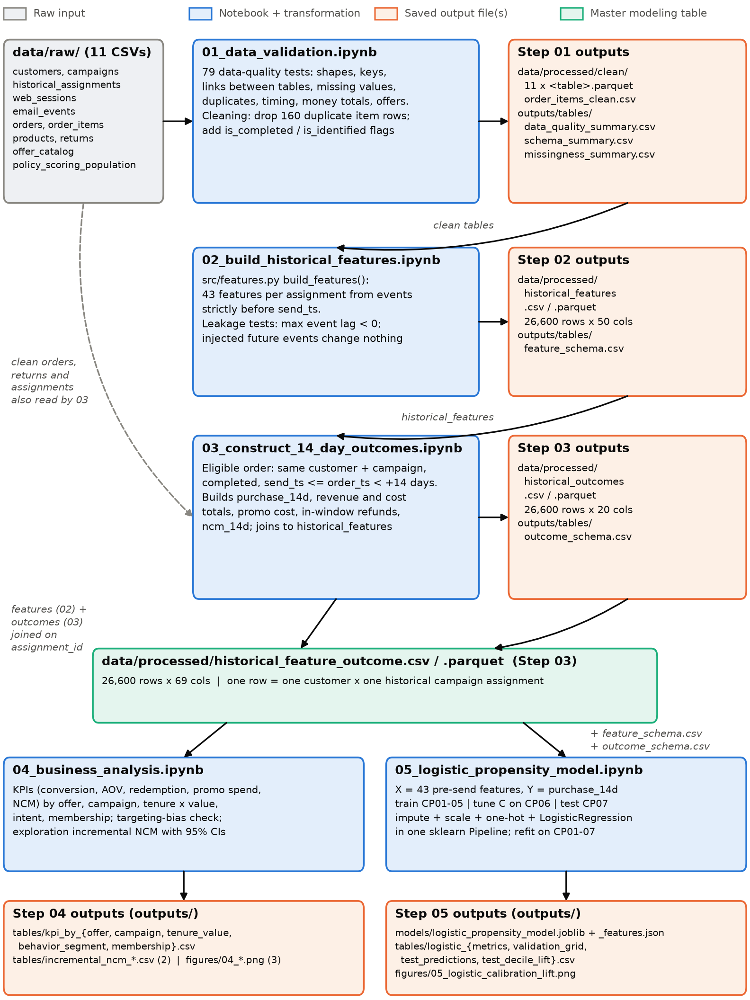
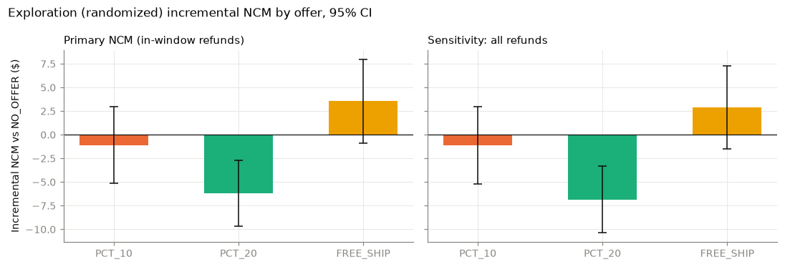
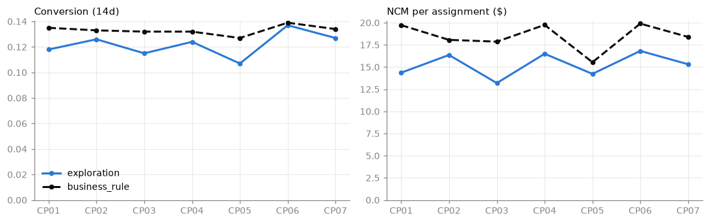
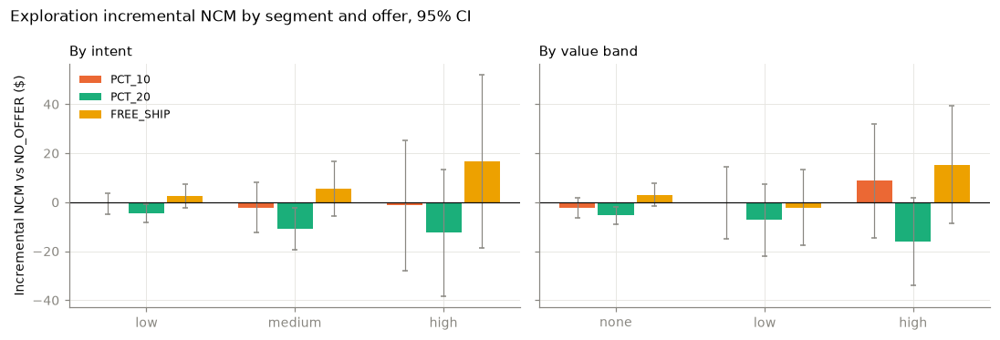
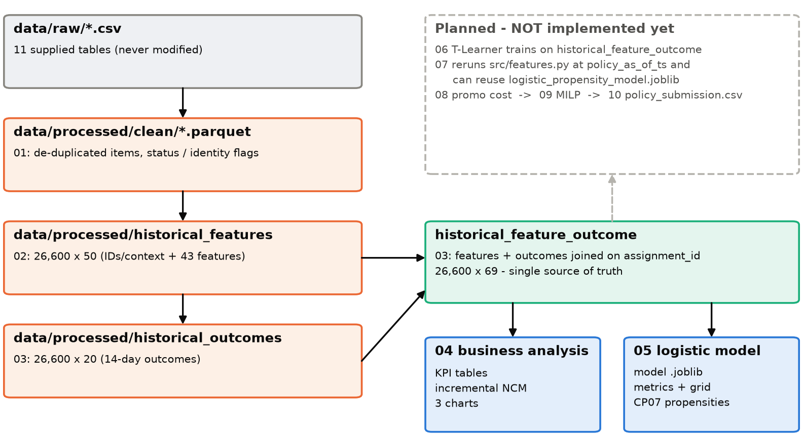

EverTrail wants to know which July customers should get `NO_OFFER`, `PCT_10`, `PCT_20` or `FREE_SHIP` to maximise *incremental* net contribution margin (NCM). The answer has to be learned from seven historical email campaigns (CP01–CP07, January–May 2025).

The implemented part of the pipeline does four things:

1. **Checks and cleans the raw data (01).** Nothing is modelled until keys, links, timestamps and money totals have been verified.
2. **Describes each historical assignment twice:**
   - **What was known before the email was sent (02).** These are the *features*.
   - **What happened in the 14 days after (03).** These are the *outcomes*.

   Step 03 then joins the two into one master table, `historical_feature_outcome`.
3. **Summarises historical performance (04)** by offer, campaign and customer segment.
4. **Builds the required purchase-propensity baseline (05).** This is a Logistic Regression that ranks customers by how likely they are to buy.

| Step | Notebook | Status |
|---|---|---|
| 01 | `01_data_validation.ipynb` | Implemented, executed |
| 02 | `02_build_historical_features.ipynb` | Implemented, executed |
| 03 | `03_construct_14_day_outcomes.ipynb` | Implemented, executed |
| 04 | `04_business_analysis.ipynb` | Implemented, executed |
| 05 | `05_logistic_propensity_model.ipynb` | Implemented, executed |
| 06 | `06_tlearner_xgboost` | Planned (no file exists) |
| 07 | `07_score_july_population` | Planned (no file exists). `src/features.py` is already written so this step can reuse it. |
| 08 | `08_estimate_promotion_cost` | Planned (no file exists) |
| 09 | `09_milp_policy_optimization` | Planned (no file exists) |
| 10 | `10_generate_outputs` | Planned (no file exists) |

**How the files are linked.** There is no master script. Each notebook reads the *saved files* written by the step before it, so they must be run in order 01 → 05. Re-running a step overwrites its outputs, because the file names are fixed.

Two helper files sit outside the notebooks:
- `src/common.py`: folder paths, constants (14-day window, the four offers, CP01–CP07) and loader functions.
- `src/features.py`: the complete Step 02 feature logic.

<!-- pagebreak -->

## 2. Complete workflow chart

<!-- pagebreak -->

## 3. 01_data_validation

### Purpose
This notebook loads all 11 raw tables and runs **79 data-quality tests**. It then saves a clean copy of the data. The point is to find broken keys, duplicates, timing problems or inconsistent money fields *before* they can distort features or outcomes. If any test has status FAIL, the notebook stops (`assert`).

### Input files
| Input file (`data/raw/`) | Why it is needed |
|---|---|
| `customers.csv` | Customer keys; signup date for timing checks |
| `campaigns.csv` | Campaign send times and 14-day windows |
| `historical_assignments.csv` | Backbone: who received which offer, when |
| `web_sessions.csv` | Session keys, customer links, timestamps |
| `email_events.csv` | Must link to a valid assignment, after its send |
| `orders.csv` | Status, campaign link, financial consistency |
| `order_items.csv` | Duplicates; item totals vs order totals |
| `products.csv` | Product keys for order items |
| `returns.csv` | Must link to completed orders; refund sanity |
| `offer_catalog.csv` | The four valid actions |
| `policy_scoring_population.csv` | July customers must be valid; campaign = CP08_POLICY |

### Major code sections
| Section | What it does | Why it matters |
|---|---|---|
| Load data | Hashes every raw file (SHA-256), loads tables with parsed timestamps, compares shapes with the expected sizes | Proves raw files are never modified; catches a wrong or partial file |
| DQ registry | A `check()` helper records each test as PASS / WARN / FAIL | Produces one auditable summary table |
| A. Key uniqueness | IDs are unique and non-null for 9 tables; one assignment per customer × campaign | Joins would multiply rows if keys were duplicated |
| C. Duplicates | Exact full-row duplicates per table; removes them from `order_items`; then checks `(order_id, line_number)` is unique | Duplicated items would inflate units and revenue |
| B. Referential integrity | Every foreign key points to a real parent row; every campaign order maps to a customer-campaign assignment | Orphan records would silently drop out of joins |
| D. Missingness | Missing counts by column; checks that missing values occur only where expected | Separates legitimate blanks from data errors |
| E. Timing | Send times match the campaign table; signup ≤ send; campaign orders fall inside [send, send + 14d); organic orders precede CP01; windows don't overlap; emails come after their send; returns come after their order | Feature/outcome logic depends on clean timestamps |
| F. Financial | Valid statuses; cancelled orders are zero; net revenue = gross − discount + shipping revenue; no negative values; items reconcile to orders (tolerance $0.05); discount rate matches the redeemed offer | NCM is built from these fields |
| G. Offer values | Assigned and redeemed offers are in the catalog; redeemed offer = assigned offer | Treatment labels must be trustworthy |
| H. Summary + save | Writes the DQ tables, saves the clean tables, and re-checks the raw hashes | Gives later steps one reliable input layer |

### Important data rules / issues found
- **Duplicate order items:** 160 exact duplicate rows (16,306 → 16,146 rows). Before removal, 160 orders failed the item-to-order reconciliation; after removal, 0 did.
- **Anonymous web sessions:** 220 sessions (1.2%) have no `customer_id`. They are kept in the clean table (`is_identified = False`) but excluded from customer features.
- **Cancelled orders:** 102 orders (53 campaign-attributed, 49 organic). All their financial fields are 0. They are kept for audit, flagged `is_completed = False`, and never count as purchases.
- **Missing customer fields:** `acquisition_channel` is missing for 120 customers and `preferred_category` for 180. The customers are kept; the model treats the blank as its own "Missing" category.
- **Expected blanks:** `orders.campaign_id` is blank for exactly the 3,474 organic pre-period orders. `offer_type_redeemed` is blank exactly when `offer_redeemed = 0` (4,662 orders).
- **Refunds:** 5 refunds exceed merchandise gross revenue, but none exceeds net revenue. These are kept with status WARN.
- **Timing facts:**
  - Campaigns are sent 21 days apart, so 14-day windows never overlap.
  - Email events occur up to 3.96 days after send.
  - Returns occur 3–31 days after the order.
  - Organic orders run from 2024-07-01 to 2025-01-09.
  - 17 returns fall after the July cutoff `policy_as_of_ts` (2025-06-20 10:00).
- **July population:** none of the 2,776 `policy_scoring_population` customers appears in `historical_assignments`.

### Output files
| Output file | What it contains | Used by |
|---|---|---|
| `outputs/tables/data_quality_summary.csv` | 79 tests: name, table, failing rows, status, note | Documentation / memo |
| `outputs/tables/schema_summary.csv` | Rows, columns, dtypes and expected shape per raw table | Documentation |
| `outputs/tables/missingness_summary.csv` | Columns with missing values: count and rate | Documentation |
| `data/processed/clean/<table>.parquet` (11 files) | Clean tables: de-duplicated `order_items`; `orders` + `is_completed`; `web_sessions` + `is_identified`; the other tables unchanged | 02, 03 |
| `data/processed/clean/order_items_clean.csv` | De-duplicated items in CSV form | Inspection |

### Actual results
**79 tests: 76 PASS, 3 WARN, 0 FAIL.**

- All 11 tables match the expected shapes, for example 26,600 × 7 assignments and 6,984 × 14 orders.
- No duplicate keys were found.
- No broken links were found: every email event matches its assignment's customer and campaign, and all 3,510 campaign-attributed orders map to an assignment and fall inside its 14-day window.

The three WARN rows are:
- the 160 duplicate item rows (removed);
- the 220 anonymous sessions (excluded from features);
- the 5 large refunds (kept).

<!-- pagebreak -->

## 4. 02_build_historical_features

### Purpose
This notebook builds a description of each customer **as known at the moment the historical email was sent**.

> **One row = one customer × one historical campaign assignment** (keyed by `assignment_id`).

The same customer can appear in up to 7 campaigns, and their history differs at each send date, so each appearance gets its own row. The 26,600 rows cover 10,596 unique customers:
- 2,271 customers appear once;
- 3,378 appear twice;
- 2,855 appear three times;
- 2,092 appear four or more times.

### Inputs
- All Step 01 clean tables (`data/processed/clean/*.parquet`), loaded with `load_clean()`.
- The spine is `historical_assignments` (26,600 rows).
- The features themselves come from:
  - `customers`
  - completed `orders`
  - de-duplicated `order_items` + `products`
  - `returns`
  - identified `web_sessions`
  - `email_events`
  - earlier `historical_assignments` (prior offers and email deliveries)

### What `send_ts` means
`send_ts` is the timestamp when the historical promotional action was sent. It is the **historical decision cutoff**: a feature may use only events with timestamp **strictly earlier** than `send_ts`. Look-back windows are half-open, for example 30d = [`send_ts` − 30 days, `send_ts`).

### Feature families (43 features)
| Family | Features |
|---|---|
| Profile (8) | `customer_tenure_days`, `is_member`, `marketing_consent`, `region`, `acquisition_channel`, `customer_tier`, `preferred_category`, `shipping_zone` |
| Purchase (13) | `prior_order_count`, `orders_30d`, `orders_90d`, `days_since_last_order`, `gross_revenue_90d`, `net_revenue_90d`, `avg_order_value_90d`, `discount_amount_90d`, `cogs_90d`, `shipping_revenue_90d`, `shipping_cost_90d`, `historical_ncm_90d`, `prior_offer_redemption_rate` |
| Returns (3) | `returns_90d`, `refund_amount_90d`, `historical_return_rate` |
| Web (8) | `sessions_7d`, `sessions_30d`, `pages_viewed_30d`, `avg_pages_per_session_30d`, `cart_add_sessions_30d`, `cart_add_rate_30d`, `days_since_last_session`, `top_category_viewed_30d` |
| Email (7) | `prior_emails_delivered`, `prior_email_opens`, `prior_email_clicks`, `historical_open_rate`, `historical_click_rate`, `days_since_last_email_open`, `days_since_last_email_click` |
| Product (4) | `units_purchased_90d`, `distinct_products_90d`, `distinct_categories_90d`, `top_purchase_category_90d` |

### How the key features are calculated
| Feature | How it is calculated (code) | Business meaning |
|---|---|---|
| `customer_tenure_days` | (`send_ts` − `signup_date`) in days | How established the customer is |
| `prior_order_count` | Completed orders with `order_ts` < `send_ts` (all history) | Lifetime purchase frequency |
| `orders_90d` | Completed orders in [`send_ts` − 90d, `send_ts`) | Recent purchase frequency |
| `days_since_last_order` | Days from the latest prior completed order to `send_ts`; blank if none | Purchase recency |
| `avg_order_value_90d` | `net_revenue_90d` / `orders_90d`; blank if no orders | Typical basket (net of discount, including shipping revenue) |
| `historical_ncm_90d` | Σ over 90d orders of (net revenue − COGS − shipping cost − refunds whose `return_ts` < `send_ts`) | Recent profitability |
| `prior_offer_redemption_rate` | Earlier assignments with a commercial offer (≠ NO_OFFER, current one excluded) that were redeemed by a completed order before `send_ts`, ÷ number of such offers; blank if none | Deal responsiveness |
| `historical_return_rate` | Prior completed orders with a return known before `send_ts` ÷ prior completed orders; blank if none | Return propensity |
| `cart_add_rate_30d` | Sessions with `added_to_cart` = 1 ÷ sessions in the last 30d (identified sessions only) | Recent shopping intent |
| `top_category_viewed_30d` | Most-viewed category in 30d; ties broken alphabetically | Current interest |
| `historical_open_rate` | Email opens before `send_ts` ÷ earlier delivered campaign emails | Email engagement |
| `top_purchase_category_90d` | Category with the most units bought in 90d (de-duplicated items) | Product affinity |

Counts and sums are 0 when there is no history. Rates and "days since" features are left **blank** when undefined (Step 05 imputes them and adds missing-value flags).

**Deliberately excluded:**
- `products.return_rate_prior`: the data dictionary doesn't say when it was measured.
- `email_delivered`: kept only as context.

### Leakage protection
Every event family goes through one helper, `_prior()`. It joins events to the assignment by `customer_id` and keeps only rows where the event is earlier than the cutoff:

`m = m[(m[ts] <= m[cut]) if inclusive else (m[ts] < m[cut])]`

Historical rows call it with `inclusive=False` (strictly before `send_ts`). Refunds inside `historical_ncm_90d` get the same filter on `return_ts`. In the notebook, three tests check this:

1. **Max-lag audit.** For every family, the latest event used must be before the send. The results, in hours before send, are:
   - purchases −132.8
   - refunds −3.7
   - returns −3.7
   - web −0.47
   - email −409
   - prior assignments −504

   All are negative: **PASS**.
2. **Perturbation test.** 400 rows (one per customer) are chosen. Fake orders, items, returns, web sessions and email clicks are injected at or after each row's `send_ts`, and the features are rebuilt. All 43 features come out identical: **PASS**.
3. **First-campaign test.** CP01 rows have zero prior emails, opens and clicks, and a blank prior-redemption rate: **PASS**.

**Pre-send information becomes a feature; post-send behaviour becomes an outcome (Step 03).** For example, an email click two days after the CP03 send can count toward CP04 features, but never toward CP03 features.

**Current implementation assumption:** profile fields such as tier and membership have no effective-date history, so their supplied values are treated as known at decision time.

### Output
`data/processed/historical_features.csv` / `.parquet` has **26,600 rows × 50 columns**:
- 7 ID/context columns: `assignment_id`, `customer_id`, `campaign_id`, `send_ts`, `assignment_source`, `offer_type`, `email_delivered`
- 43 features

`outputs/tables/feature_schema.csv` lists each column's family and its type (numeric or categorical).

Each campaign has 3,800 rows. Treatment distribution:

| offer_type | business_rule | exploration | total |
|---|---|---|---|
| NO_OFFER | 4,806 | 1,826 | 6,632 |
| PCT_10 | 8,538 | 1,902 | 10,440 |
| PCT_20 | 1,868 | 1,893 | 3,761 |
| FREE_SHIP | 3,861 | 1,906 | 5,767 |
| **Total** | **19,073** | **7,527** | **26,600** |

**Missing values (by design).** Most customers have little recent activity:
- `days_since_last_order` is blank for 19,009 rows (no prior order);
- `avg_pages_per_session_30d` and `cart_add_rate_30d` are blank for 23,952 rows (no session in 30d);
- `historical_open_rate` is blank for 10,835 rows (no earlier email).

**Example row:** `A000006233`, customer 103516, CP02, business_rule, PCT_10.
- Tenure: 367 days.
- History: no prior orders and no sessions; 1 earlier email, which was opened 20.7 days before the send; prior offer redemption rate 0.

<!-- pagebreak -->

## 5. 03_construct_14_day_outcomes

### Purpose
**Features describe information available BEFORE the promotion. Outcomes describe what happened AFTER it.** This notebook measures each assignment over the 14 days after its send:

`send_ts (day 0)  ──────── outcome window ────────▶  outcome_end_ts = send_ts + 14 days`

### Inputs
- From the Step 01 clean tables:
  - `historical_assignments`
  - `orders` (with `is_completed`)
  - `returns`
  - `offer_catalog` (loaded but not used in any calculation)
- From Step 02: `historical_features`.
- `order_items` is not used here.

### purchase_14d
An order is **eligible** for an assignment only if all four conditions hold:
1. same `customer_id`
2. same `campaign_id`
3. `order_status = completed`
4. `send_ts ≤ order_ts < send_ts + 14 days`

`purchase_14d = 1` means the customer placed **at least one eligible completed order for that campaign** within 14 days. Otherwise it is 0.

How the edge cases are handled:
- **Cancelled orders** (53 campaign-linked) are excluded.
- **Multiple orders** would be summed. In practice each purchasing assignment has exactly one order: 3,457 eligible orders for 3,457 buyers.
- **Double counting.** The code asserts that no order is attached to two assignments.
- **Organic orders.** The 3,474 organic orders have no campaign, so they never become outcomes.

### Financial outcome fields
`gross_revenue_14d`, `discount_amount_14d`, `shipping_revenue_14d`, `net_revenue_14d`, `cogs_14d` and `shipping_cost_14d` are sums over eligible orders (0 for non-buyers). The other outcome fields are:

| Field | Definition |
|---|---|
| `order_count_14d` | Number of eligible orders |
| `offer_redeemed_14d` | 1 if an eligible order has `offer_redeemed = 1` and the redeemed offer equals the assigned offer |
| `promo_cost_14d` | On redeemed orders: discount amount + waived shipping fee; 0 otherwise |
| `promo_cost_inferred` | 1 for FREE_SHIP assignments that redeemed, meaning the cost is inferred |
| `refund_amount_applicable` | Refunds on eligible orders whose `return_ts` < `outcome_end_ts` |
| `in_window_return_count`, `post_window_return_count`, `post_window_refund_amount` | Return timing audit |
| `ncm_14d` | Main NCM outcome (formula below) |
| `ncm_14d_all_returns` | `ncm_14d` − `post_window_refund_amount`, for sensitivity checks |
| `aov_14d` | `net_revenue_14d` / `order_count_14d`; blank for non-buyers |

### NCM: the exact implemented formula
`ncm_14d = net_revenue_14d − cogs_14d − shipping_cost_14d − refund_amount_applicable`

The four components are:
- **Net revenue:** what the customer paid, already equal to merchandise gross − discount + shipping revenue.
- **COGS:** the cost of the goods sold.
- **Shipping cost:** EverTrail's cost of fulfilment.
- **Applicable refunds:** money returned to the customer.

Discounts and shipping revenue are inside net revenue, so they are not subtracted a second time. The notebook checks that the equivalent long form, gross − discount + shipping revenue − COGS − shipping cost − refunds, matches within $0.01.

**Current implementation assumption: return timing.** Walmart requires "applicable returns" but gives no timing rule. The code counts a refund only if the return happens **inside the same 14-day window** (`RETURN_RULE = "in_window"`, which is one setting in the notebook). Returns arrive 3–31 days after purchase, so most refunds land after day 14:
- **60 in-window returns, $15,402**
- **309 post-window returns, $83,776**

Post-window refunds are kept in `post_window_refund_amount`, and `ncm_14d_all_returns` shows NCM if they were also subtracted.

**Current implementation assumption: FREE_SHIP promo cost.** The data never records the waived fee. In every non-FREE_SHIP completed order, a $5.99 fee appears only when merchandise gross is below $75: the highest gross with a fee is $74.99, and the lowest without one is $75.08. The code infers a $5.99 waived fee for redeemed FREE_SHIP orders below $75.08. This applies to 45 of the 712 redeemed orders, $269.55 in total. The NCM itself is unaffected, because net revenue already excludes the waived fee.

### Output files
| File | Content | Used by |
|---|---|---|
| `data/processed/historical_outcomes.csv` / `.parquet` | 26,600 × 20: `assignment_id` + 19 outcome/audit columns | Joined into the master table |
| `data/processed/historical_feature_outcome.csv` / `.parquet` | 26,600 × 69: features + outcomes (one-to-one join on `assignment_id`) | 04, 05, and later 06 |
| `outputs/tables/outcome_schema.csv` | List of outcome columns | 05 uses it to keep outcomes out of X |

`historical_feature_outcome` is the **single source of truth**. It puts "what we knew" and "what happened" side by side for every assignment, which is exactly what a propensity model, an uplift model or a KPI table needs. The notebook verifies:
- one row per assignment, with none dropped;
- `purchase_14d` is binary and has no blanks;
- the outcome totals equal the eligible-order totals;
- NO_OFFER rows have zero promotion cost and zero redemption;
- no outcome column is registered as a feature.

### Actual output results
| Measure | Value |
|---|---|
| Rows / unique customers / campaigns | 26,600 / 10,596 / CP01–CP07 (3,800 each) |
| Buyers (`purchase_14d` = 1) | 3,457 (13.0%) |
| Purchase rate by campaign | CP01 13.1% · CP02 13.1% · CP03 12.7% · CP04 13.0% · CP05 12.2% · CP06 13.8% · CP07 13.2% |
| Purchase rate by offer (all sources) | NO_OFFER 17.1% · FREE_SHIP 12.4% · PCT_10 11.3% · PCT_20 11.3% |
| Total net revenue / COGS / shipping cost | $1,216,969 / $703,589 / $30,971 |
| Total discount / promotion spend | $69,083 / $69,352 (discounts + $270 inferred FREE_SHIP) |
| Total NCM (in-window refunds) / with all refunds | $467,008 / $383,232 |
| NCM per assignment: mean / median | $17.56 / $0 (most rows have no purchase) |
| NCM per buyer: mean / median / range | $135.09 / $97.86 / −$448.03 to $1,051.69 (60 buyers negative) |
| AOV (buyers): mean / median | $352.03 / $268.74 |
| Missing outcomes | Only `aov_14d`, blank for 23,143 non-buyers (by design) |

<!-- pagebreak -->

## 6. 04_business_analysis

### Purpose
This notebook answers **what historically happened under different campaigns, offers and customer groups**. It reads `data/processed/historical_feature_outcome.parquet` and nothing else. It does not rebuild any features or outcomes.

**KPI definitions** (function `kpis()`):
- **Conversion:** mean of `purchase_14d`.
- **AOV:** net revenue ÷ orders.
- **Redemption:** redeemed ÷ offered assignments.
- **Promo spend:** Σ `promo_cost_14d`.
- **NCM:** total and per assignment.

Overall:
- conversion 13.0%
- AOV $352.03
- redemption 11.6%
- promo spend $69,352
- NCM $17.56 per assignment

### Targeting bias check
**Question:** do different offers go to different kinds of customers?

**Calculation:** the standardised mean difference of 7 pre-send features between each offer group and NO_OFFER, computed separately within each assignment source. The result is printed in the notebook only (not saved).

**Result:**
- Under `business_rule`, NO_OFFER customers differ strongly from the others: largest gap 0.44 SD for `prior_order_count`, 0.34 for `sessions_30d` and 0.27 for `historical_ncm_90d`.
- Under `exploration`, every gap is at most 0.07, and each offer gets about 25% of rows. In business_rule, the mix is PCT_10 45%, NO_OFFER 25%, FREE_SHIP 20% and PCT_20 10%.

**Interpretation:** EverTrail's normal targeting withheld offers from its most active customers. Comparing offers inside business_rule therefore mixes the offer's effect with who received it. Only exploration rows support causal statements.

### Conversion and NCM by offer (`kpi_by_offer.csv`)
**Question:** did customers given different offers buy and earn differently?

**Calculation:** the KPIs grouped by `offer_type` × `assignment_source`.

| Offer | Conv. explor. | NCM/assign. explor. | Conv. business_rule | NCM/assign. business_rule |
|---|---|---|---|---|
| NO_OFFER | 11.3% | $16.21 | 19.3% | $30.61 |
| PCT_10 | 12.1% | $15.13 | 11.2% | $11.00 |
| PCT_20 | 12.4% | $10.03 | 10.2% | $7.17 |
| FREE_SHIP | 13.1% | $19.77 | 12.0% | $25.26 |

**Interpretation:**
- **Business_rule:** NO_OFFER looks best (19.3%), but that reflects targeting, not the absence of an offer.
- **Exploration:** offers raise conversion by only about 1–2 points.
- **Discount cost:** PCT_20 has the highest promo cost per assignment ($8.89 in exploration).

### Incremental NCM vs NO_OFFER (`incremental_ncm_exploration.csv`, Figure 2)
**Question:** does an offer create extra NCM compared with sending nothing?

**Calculation:** in exploration rows only, mean `ncm_14d` (offer) − mean `ncm_14d` (NO_OFFER), with a 95% CI from the two-sample standard error. The file also contains a "naive" business_rule version, included only to show the bias.

| Offer | Extra conversion | Extra NCM / assignment | 95% CI | All-refunds version | Naive business_rule |
|---|---|---|---|---|---|
| PCT_10 | +0.8 pts | −$1.08 | −$5.12 to +$2.96 | −$1.11 | −$19.61 |
| PCT_20 | +1.1 pts | **−$6.17** | −$9.65 to −$2.70 | −$6.85 | −$23.45 |
| FREE_SHIP | +1.8 pts | **+$3.56** | −$0.89 to +$8.01 | +$2.87 | −$5.36 |

**Interpretation:**
- **PCT_20 reliably destroys margin:** the discount given away on purchases that would have happened anyway outweighs the extra purchases.
- **PCT_10** shows no measurable effect.
- **FREE_SHIP** is the most promising offer, but its interval still includes 0.
- **The naive comparison** would wrongly show every offer losing $5–23.

This is a population-average estimate. It does not say which *individual* customers respond, which is the job of Step 06.

### Campaign stability (`kpi_by_campaign.csv`, Figure 3)
**Question:** are results stable over time?

**Calculation:** the KPIs by `campaign_id` × source.

**Result:** exploration conversion ranges from 10.7% (CP05) to 13.7% (CP06), and NCM per assignment from $13.19 to $16.82. No campaign is an outlier.

**Interpretation:** stable behaviour supports training on earlier campaigns and testing on later ones (Step 05).

### Segments (`kpi_by_tenure_value.csv`, `kpi_by_behavior_segment.csv`, `kpi_by_membership.csv`, `incremental_ncm_by_segment_exploration.csv`)
The segments are defined inside notebook 04. They are **not saved** to the master table.

| Segment | Definition | Rows |
|---|---|---|
| Tenure band | `customer_tenure_days` < 1 year / 1–2 years / 2+ years | 6,555 / 9,316 / 10,729 |
| Value band | `none` = no completed order in the prior 90 days; otherwise `historical_ncm_90d` below / above the buyers' median ($102.90) = low / high | 22,900 / 1,850 / 1,850 |
| Intent (behavioural) | high = cart-add session in the last 30d; medium = any session in the last 30d, or a last visit 31–90d ago; low = no session in 90d | 1,052 / 5,681 / 19,867 |

**Results:**
- **Value bands:** customers with recent high value convert at 18.6–21.1% and earn $26.84–$34.68 per assignment, versus about 12% and $16–17 for customers with no recent purchase.
- **Intent:** high-intent customers convert at 15–25%, depending on offer.
- **Exploration incremental NCM by segment:**
  - FREE_SHIP has its largest point estimates for high intent (+$16.53) and high value (+$15.37);
  - PCT_20 is negative in every segment;
  - PCT_10 is clearly positive only for customers under 1 year (+$4.85) and high value (+$8.77).
- **Statistically significant (CI excludes 0):**
  - PCT_20 is negative for 2+ year tenure, no-recent-purchase, low and medium intent, members and non-members;
  - FREE_SHIP is **positive for non-members (+$6.31, CI +$1.01 to +$11.61)** but −$3.38 for members. A plausible reason is that members may already get shipping perks; the data doesn't confirm this.

**Interpretation:** most segment intervals are wide because the groups are small. Treat the segment differences as **hypotheses for the Step 06 uplift model**. The non-member FREE_SHIP effect is the strongest lead.

### Output files
| File | Role / later use |
|---|---|
| `outputs/tables/kpi_by_offer.csv`, `kpi_by_campaign.csv` | Memo and deck KPI tables; dashboard |
| `outputs/tables/kpi_by_tenure_value.csv`, `kpi_by_behavior_segment.csv`, `kpi_by_membership.csv` | Segment findings; dashboard drill-down |
| `outputs/tables/incremental_ncm_exploration.csv`, `incremental_ncm_by_segment_exploration.csv` | Causal evidence for the memo; benchmark for the Step 06 model |
| `outputs/figures/04_*.png` (3 charts) | Deck and memo figures |

Not saved: the overall KPI row, the balance (targeting-bias) table and the segment labels.

<!-- pagebreak -->

## 7. 05_logistic_propensity_model

### Purpose
> This model predicts **which customers are most likely to purchase within 14 days**. It does **not** estimate the incremental effect of a promotion.

It is the required traditional baseline. It will also drive required baseline policy #2 ("send PCT_10 to the highest-propensity customers until the budget runs out").

### Input table
`data/processed/historical_feature_outcome.parquet`. The feature list comes from `outputs/tables/feature_schema.csv`, and the forbidden outcome list from `outcome_schema.csv`.

**X = 43 pre-decision features. Y = `purchase_14d`.**

### Feature set
| Group | Columns |
|---|---|
| Numeric (36) | The profile numerics (`customer_tenure_days`, `is_member`, `marketing_consent`) plus every count, amount, rate and recency feature in the purchase, returns, web, email and product families (Section 4) |
| Categorical (7) | `region`, `acquisition_channel`, `customer_tier`, `preferred_category`, `shipping_zone`, `top_category_viewed_30d`, `top_purchase_category_90d` |
| Excluded: IDs / context | `assignment_id`, `customer_id`, `campaign_id`, `send_ts`, `assignment_source`, `offer_type`, `email_delivered` |
| Excluded: outcomes | All 19 columns in `outcome_schema.csv` (`purchase_14d`, `ncm_14d`, `outcome_end_ts`, …) |

The code asserts that X contains no forbidden column.

**Why the exclusions:**
- **IDs** carry no behaviour and would let the model memorise customers.
- **Offer and source** describe the treatment, not the customer.
- **Delivery and outcome columns** happen *after* the decision and would leak the answer.

### Preprocessing (one sklearn Pipeline)
- **Numeric features:**
  - `SimpleImputer(median, add_indicator=True)` fills blanks with the median and adds a "was missing" flag;
  - then `StandardScaler`.
- **Categorical features:**
  - `SimpleImputer(constant "Missing")`;
  - then `OneHotEncoder(handle_unknown="ignore")`.
- **Model:** `LogisticRegression` with an L2 penalty, `lbfgs` solver, `max_iter=2000` and `random_state=42`. No oversampling.
- **Size:** 43 inputs become **85 encoded columns**.

Preprocessing and model are saved together, so July data can be scored without repeating any manual steps.

### Train / validation / test strategy
`Train: CP01–CP05 (19,000 rows, 12.8% buy)  →  Validation: CP06 (3,800, 13.8%)  →  Test: CP07 (3,800, 13.2%)`

The split is by campaign, in time order. The model learns from earlier campaigns and is judged on a later one it never saw, which mimics predicting July. A random row split would mix the same customer's campaigns across train and test.

`C ∈ {0.01, 0.1, 1, 10}` was compared on CP06 by ROC-AUC (log loss breaks ties), and **C = 0.01** was selected. CP07 was scored once. The final saved model was then **refit on all of CP01–CP07**.

### What Logistic Regression does here
Think of the model as a **points system**. For every customer it adds up points from their pre-send information. For example:
- being a Gold-tier customer adds points;
- being Standard tier takes points away;
- recent browsing adds points;
- having no browsing history takes points away.

The total is converted into a percentage chance of buying within 14 days. The model learned how many points each piece of information is worth from campaigns CP01–CP05, and it never sees anything that happened after the email was sent.

### How to read the results, step by step

**Step 1: What we are comparing against.** CP07 is the test campaign the model never saw. It has 3,800 customers, and 501 of them bought (13.2%). A model with **no skill** would give every customer the same 13.2% chance and couldn't tell buyers from non-buyers. Every result below asks one question: does the model do better than that?

**Step 2: Does the model put the buyers near the top of its list?** This is the most important question. The CP07 customers were sorted by predicted chance and cut into 10 equal groups of 380 (`logistic_test_decile_lift.csv`):

| Group (1 = highest scores) | Predicted chance in this group | Customers | Actually bought | Purchase rate | If the list were random |
|---|---|---|---|---|---|
| 1 | 22.7%–46.8% | 380 | **109** | **28.7%** | ≈ 50 buyers |
| 2 | 17.7%–22.6% | 380 | 71 | 18.7% | ≈ 50 |
| 3 | 15.1%–17.7% | 380 | 69 | 18.2% | ≈ 50 |
| 4 | 12.0%–15.1% | 380 | 56 | 14.7% | ≈ 50 |
| 5 | 9.8%–12.0% | 380 | 46 | 12.1% | ≈ 50 |
| 6 | 8.6%–9.8% | 380 | 29 | 7.6% | ≈ 50 |
| 7 | 7.7%–8.6% | 380 | 39 | 10.3% | ≈ 50 |
| 8 | 6.9%–7.7% | 380 | 35 | 9.2% | ≈ 50 |
| 9 | 6.3%–6.9% | 380 | 14 | 3.7% | ≈ 50 |
| 10 | 1.4%–6.3% | 380 | 33 | 8.7% | ≈ 50 |

**How to read the table:**
- **The top group found more than twice as many buyers as random:** 109 instead of about 50. That is the "2.2× lift".
- **The top 30% of the list (1,140 customers) holds 249 of the 501 buyers.** Half of all buyers sit in less than a third of the list.
- **The bottom groups are mostly below average.** The ordering isn't perfect: group 10 has more buyers than group 9. This shows the model separates "likely" from "unlikely" well, but not finely within the low-probability groups.

**ROC-AUC = 0.655 summarises the same idea in one number.** Pick one random buyer and one random non-buyer from CP07, and the model gives the buyer the higher score 65.5% of the time. A coin flip would manage 50%, and a perfect model 100%. On average, buyers were given a 16.0% chance and non-buyers 11.9%. The verdict: the model has **useful, real ranking power, but it is far from perfect**.

**PR-AUC = 0.231** asks: as you go down the ranked list picking customers, what share of the people you pick are real buyers? The answer averages about 23%, compared with the 13.2% you'd get by picking at random.

**Step 3: Can the percentages be taken literally?** This is called *calibration*.
- **The top group lines up:** the model predicted about 27.7% on average, and 28.7% actually bought.
- **The whole campaign lines up:** the average prediction was 12.5%, against 13.2% actual.
- **So the numbers can be read as real chances.** A predicted 0.186 means "roughly a 19% chance of buying within 14 days".

The left chart in Figure 5 shows this: the blue line stays close to the dashed "perfect" line.

**Log loss (0.373) and Brier score (0.110)** both measure how far the predicted percentages were from what happened. Lower is better. The no-skill model (13.2% for everyone) would score 0.390 and 0.1145, so this model is better, but only slightly. These two scores are mainly useful for comparing model versions, not for business decisions.

**Step 4: Why precision, recall and F1 show 0 at the 0.50 cut-off.** The highest chance the model gave anyone in CP07 was 46.8%, so it never thinks a customer is *more likely than not* to buy. That's reasonable when only 13% of customers buy. A rule of "predict a purchase if the chance is above 50%" therefore selects nobody, and precision and recall come out as 0. **This is not a failure.** The model is meant to *rank* customers, not to say yes or no.

With a lower cut-off of 17.2% (chosen on CP06), the yes/no numbers become meaningful:
- **Who gets flagged:** 819 customers in CP07, of whom **193 bought**. That's a precision of 23.6%, compared with 13.2% for random picks.
- **Who gets caught:** those 193 are **38.5% of all 501 buyers** (the recall).
- **What it misses:** 626 flagged customers did not buy, and 308 buyers were not flagged.

**Step 5: Is the result stable?**
- **Across campaigns:** ROC-AUC was 0.686 on the validation campaign (CP06) and 0.655 on the test campaign (CP07). A small drop on a new campaign is normal, and the model still clearly beats random.
- **Across settings:** the regularisation setting C barely mattered (0.684–0.686 on CP06), so the result doesn't depend on that choice.
- **Not available:** training-set scores are not saved by the current code.

| Split | ROC-AUC | PR-AUC | Log loss | Brier | Actual buy rate | Average predicted |
|---|---|---|---|---|---|---|
| Validation CP06 | 0.686 | 0.265 | 0.376 | 0.112 | 13.8% | 12.7% |
| **Test CP07** | **0.655** | **0.231** | **0.373** | **0.110** | 13.2% | 12.5% |
| No-skill reference (CP07) | 0.500 | 0.132 | 0.390 | 0.1145 | 13.2% | 13.2% |

**Step 6: What drives the score?**
- **Customer tier matters most.** Across all historical rows, Gold customers bought 28.8% of the time, Silver 16.3% and Standard 7.4%. In the saved model, Gold carries a coefficient of +0.58 and Standard −0.65 (positive raises the chance, negative lowers it).
- **Browsing history matters next.** Customers with at least one recorded web session before the send bought 16.7% of the time, against 9.0% for customers never seen on the website.
- **Smaller effects** come from recent spending, recent profit, and email and offer history.

(The coefficient table printed inside notebook 05 comes from the CP01–05 model, so its values differ slightly from the saved final model.)

**Step 7: What this means for the project.**
- **What it does well:** the model is a decent answer to "who is likely to buy?". The top 30% of its list contains half of the buyers.
- **What it can't do:** it can't answer "who buys *because of* an offer?". The customers it rates highest, such as Gold tier and recent browsers, are largely people who would buy anyway, and Step 04 showed that giving them discounts loses money.
- **How it will be used:** only as the **required baseline**, which sends PCT_10 to the highest-scoring customers until the budget runs out. The final policy will be judged against it.

### Propensity score output
`outputs/tables/logistic_test_predictions.csv` holds one row per CP07 assignment, with these columns:
- `assignment_id`
- `customer_id`
- `campaign_id`
- `purchase_14d`
- `predicted_purchase_probability`

Across CP07, predicted probabilities range from 0.014 to 0.468 (mean 0.125). For example, assignment A000022803 has `predicted_purchase_probability = 0.186`. That means the model estimates about an **18.6% chance this customer places an eligible completed order within the 14-day window**, compared with about 12.5% for a typical CP07 customer.

This probability is **not**:
- incremental NCM;
- causal uplift;
- the probability that the promotion *caused* the purchase.

A high-propensity customer may buy anyway, and sending them a discount can *lower* profit (Section 6). This is why the project needs the Step 06 T-Learner. The saved model `outputs/models/logistic_propensity_model.joblib` and `logistic_model_features.json` are ready for Step 07. July (CP08) has **not** been scored.

<!-- pagebreak -->

## 8. How all output files link together

| Output file | Created by | What it contains | Used by |
|---|---|---|---|
| `data/processed/clean/*.parquet` (11) | 01 | Clean versions of every raw table | 02, 03 |
| `data/processed/clean/order_items_clean.csv` | 01 | De-duplicated items (CSV) | Inspection |
| `outputs/tables/data_quality_summary.csv` | 01 | 79 DQ tests with status | Memo / README |
| `outputs/tables/schema_summary.csv`, `missingness_summary.csv` | 01 | Table shapes and dtypes; missing values | Documentation |
| `data/processed/historical_features.csv` / `.parquet` | 02 | 26,600 × 50 pre-send features | 03 |
| `outputs/tables/feature_schema.csv` | 02 | Feature family and type list | 03 (check), 05 (X columns) |
| `data/processed/historical_outcomes.csv` / `.parquet` | 03 | 26,600 × 20 outcomes | Joined into master |
| `data/processed/historical_feature_outcome.csv` / `.parquet` | 03 | 26,600 × 69 master table | 04, 05, future 06 |
| `outputs/tables/outcome_schema.csv` | 03 | Outcome column list | 05 (leakage guard) |
| `outputs/tables/kpi_by_*.csv` (5) | 04 | KPI tables | Memo, deck, dashboard |
| `outputs/tables/incremental_ncm_*.csv` (2) | 04 | Randomized offer effects | Memo; Step 06 benchmark |
| `outputs/figures/04_*.png` (3) | 04 | Charts | Deck / memo |
| `outputs/tables/logistic_validation_grid.csv`, `logistic_metrics.csv` | 05 | Tuning and evaluation | Memo |
| `outputs/tables/logistic_test_predictions.csv`, `logistic_test_decile_lift.csv` | 05 | CP07 propensities and lift | Memo; baseline comparison |
| `outputs/figures/05_logistic_calibration_lift.png` | 05 | Diagnostics chart | Memo |
| `outputs/models/logistic_propensity_model.joblib` + `_features.json` | 05 | Trained pipeline + feature specification | Future 07 (baseline policy #2) |

## 9. Important variables cheat sheet

| Variable | Meaning |
|---|---|
| `customer_id` | Unique customer identifier (15,000 customers in total) |
| `campaign_id` | Campaign identifier: CP01–CP07 historical; CP08_POLICY = July |
| `assignment_id` | One customer × one historical campaign assignment; the row key of the master table |
| `send_ts` | Time the historical action was sent; the feature cutoff (features use events strictly before it) |
| `outcome_end_ts` | `send_ts` + 14 days; end of the outcome window |
| `offer_type` | Action received: NO_OFFER, PCT_10 (10% off merchandise), PCT_20 (20% off), FREE_SHIP (free standard shipping) |
| `assignment_source` | `exploration` (randomized test) or `business_rule` (normal targeting). Only exploration supports unbiased offer comparisons; this is central to the Step 06 causal design |
| `email_delivered` | Whether the email arrived; context only, not a model feature |
| `purchase_14d` | 1 = at least one eligible completed order in the window; target of the Step 05 model |
| `ncm_14d` | 14-day NCM = net revenue − COGS − shipping cost − in-window refunds; planned target of Step 06 |
| `ncm_14d_all_returns` | NCM also subtracting refunds after day 14 (sensitivity) |
| `promo_cost_14d` | Realized promotion cost (discount, or inferred waived shipping) |
| `is_completed`, `is_identified` | Step 01 flags: order counts as a purchase / web session has a known customer |
| `predicted_purchase_probability` | Step 05 output: estimated chance of purchase within 14 days |
| `policy_as_of_ts` | July feature cutoff (2025-06-20 10:00). Step 07 will use events ≤ this time (inclusive) |

<!-- pagebreak -->

## 10. What the current results mean

1. **Dataset size.** The master table has 26,600 assignment rows, 69 columns and 10,596 unique customers across 7 campaigns. 7,527 rows (28%) come from randomized exploration.
2. **Data quality.** The data is in good shape: 0 failures. The issues found were all handled:
   - 160 duplicate item rows were removed;
   - 220 anonymous sessions were excluded from features;
   - 102 cancelled orders are never counted as purchases;
   - 5 large refunds were kept.
3. **Overall purchase rate:** 13.0% within 14 days.
4. **By campaign:** 12.2–13.8%, which is stable.
5. **By offer (pooled):**
   - NO_OFFER 17.1% vs 11.3–12.4% for offers. This is driven by targeting.
   - In randomized exploration, offers lift conversion by only +0.8 to +1.8 points.
6. **Money:**
   - Total NCM is $467K, or $17.56 per assignment and $135 per buyer.
   - Promotion spend is $69.4K, almost all discounts.
   - Counting refunds after day 14 would lower NCM by $84K.
7. **Offer economics (randomized):**
   - PCT_20 costs about $6.17 per assignment (significant);
   - PCT_10 ≈ $0;
   - FREE_SHIP is about +$3.56 (not yet significant).
8. **Customer behaviour:** recent high-value and high-intent customers buy much more often. FREE_SHIP is significantly positive for non-members (+$6.31) but not for members. Other segment-level effects point the same way (FREE_SHIP strongest for engaged customers) but rest on small samples.
9. **Logistic performance:** CP07 test ROC-AUC 0.655, PR-AUC 0.231, Brier 0.110. The model is reasonably calibrated.
10. **What it captures well:** ranking buyers. The top decile buys at 2.2× average, driven mainly by customer tier, browsing and past spend.
11. **What it does not solve:**
    - It ignores the offer, so it cannot say whether an offer changes behaviour or what that is worth.
    - It does not include promotion cost or margin.
    - It does not respect the budget or offer-mix constraints.
12. **Why it is only a baseline.** Targeting the likeliest buyers sends discounts to people who would buy anyway. The Step 04 evidence shows this loses margin. The final policy must instead rank customers by *incremental* NCM.

**Not yet provided by the current pipeline:**
- customer-level incremental NCM;
- July scoring;
- expected promotion cost per action;
- the optimized policy;
- the comparison against the three required baseline policies;
- `policy_submission.csv`.
